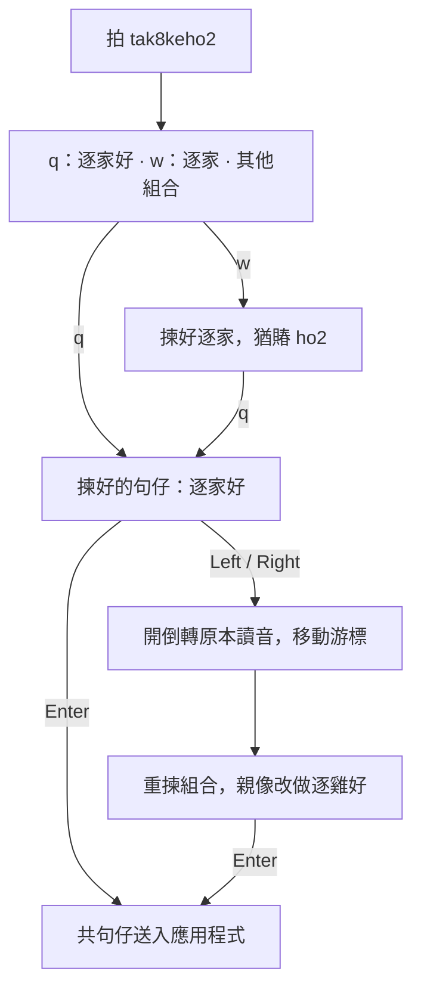
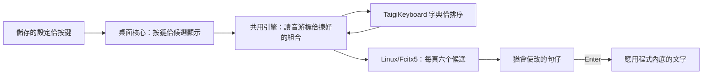

> Historical Obsidian export, captured November 6, 2026. The original report's
> versions, test totals, and installation claims apply to its recorded revision.
> Machine-specific paths were made portable; referenced local artifacts are
> identified but are not included here. See [export provenance](README.md) and
> [current development progress](../../PROGRESS.md) before following old commands.

# TaigiKeyboard 修改報告 — 台語漢字

報告日子：2026 年 10 月 8 日（Asia/Taipei）  
範圍：本機程式修改、Linux/Fcitx5 安裝、驗證，佮工作資料夾整理。技術名詞保留 English。

## 修改結果

我共 TaigiKeyboard 加入一个會使開關的句仔編輯模式，參考意傳的操作方式，用英文字母揀漢字組合。揀好的字猶留佇輸入法內底，按 Enter 才共規句送入應用程式。你的帳號已經開啟這个模式，重開 Fcitx5 了後嘛有驗證成功。

這个版本猶是用 TaigiKeyboard 家己的引擎佮字典，無共 Rime 嵌入來，嘛無重做意傳全部的功能。

## 參考意傳的啥物設計

我有看本機安裝的意傳 `pojhan` schema，閣用真正的 librime library，佇獨立的測試 session 試操作。主要參考的是：每頁六个候選，用 `q w d f z x` 揀；會使揀完整的組合，嘛會使先揀讀音前半段的較短組合；游標會使佇原本的羅馬字內底移動。

進前逐个漢字分開改的版本已經撤掉。這馬是轉去原本的讀音，閣重揀組合。

實際參考的過程有留佇意傳操作紀錄 (original local artifact: `issues/taigikeyboard-20261008/logs/validation/ithuan-reference-letter-flow.txt`)。

## 按怎使用

| 操作 | 結果 |
|---|---|
| 拍 `tak8keho2` | 顯示 `逐家好`、`逐家` 等漢字組合。 |
| 按 `q` | 揀頭一个組合 `逐家好`。 |
| 嘛會使按 `w`，閣按 `q` | 先揀 `逐家`，閣對賰的 `ho2` 揀 `好`。 |
| 按 Left/Right | 佇原本羅馬字內底移動游標；向左行入揀好的組合，就會開倒轉彼段讀音。 |
| 按 End | 移到賰的讀音上尾。 |
| 按 PageUp/PageDown | 換候選頁，每頁六个。 |
| 按 Space | 揀目前反白的候選，句仔猶留佇輸入法內底。 |
| 按 Enter | 若有作用中的候選，先確定彼个組合，閣共句仔送入應用程式。 |
| 按 Escape | 取消輸入中的句仔。 |

數字鍵是用來拍聲調，這个模式用 Standard 聲調設定。顯示模式佮漢字／羅馬字的順序會照你的設定，毋免關掉句仔模式。Combined 會使分開揀漢字佮羅馬字；Romanization Only 會使揀羅馬字；漢羅對應會照設定的順序。Shift 加選字字母會揀另外一个 script。

欲修改的例：先揀 `逐家好`，向左按三擺，予讀音游標停佇 `tak8ke` 後壁。揀較短的 `逐`，閣對 `ke` 揀 `雞`。按 End，對 `ho2` 揀 `好`，上尾按 Enter，就送出 `逐雞好`。這是照讀音範圍重揀組合，Left 並毋是直接揀前一个漢字格仔。



## 套件內底改了啥物

| 部分 | 修改佮用途 |
|---|---|
| 共用組句引擎（`engine/composing`） | 揀好的組合留佇輸入法內底；照游標前面的讀音查候選；保留後壁未處理的讀音；會使開倒轉揀好的組合。查候選佮學習紀錄用仝一个讀音範圍。 |
| 設定 protocol（`engine/protos`） | 加入可選的 `editable_sentence_enabled` 欄位，預設是關的。 |
| 桌面核心（`desktop/crates/taigi-desktop-core`） | 儲存 `editableSentenceEnabled`；處理六个選字字母；一个組合顯示一列；較長的讀音組合排佇頭前；用 Enter 確定規句。這个模式無自動佇詞尾加空白。 |
| Linux runtime（`linux/crates/taigi-linux-core`） | 候選標籤、換頁、滑鼠揀字佮字母揀字，攏用仝款的六个候選分頁。 |
| 測試佮文件 | 加組合選擇、讀音重揀的測試，以及安裝了後的檢查程式佮使用說明。 |

另外有共測試內底建立設定的所在補上新欄位。這擺無加新的語音拼寫規則。



## 安裝佮重開了後的狀況

本機修改是對 upstream TaigiKeyboard 3.6.13 做的，安裝做這个使用者的 Fcitx5 addon。系統的 3.6.10 套件猶留咧。使用者的 addon 設定指向 `~/.local/lib/taigikeyboard-sentence/libtaigikeyboard.so`。

配合的字典囥佇 addon 家己的 `prefix/share/taigikeyboard/dictionaries/`。新引擎無法度讀舊系統套件的 association 檔案格式，所以引擎佮字典愛用配合的版本。這嘛有修好進前無漢字候選的安裝問題。

`~/.config/taigikeyboard/settings.json` 內底的 `values.editableSentenceEnabled` 已經儲存做 `true`。重開應用程式抑是 Fcitx5，功能猶會留咧。這擺無另外做規台電腦重新開機的驗證。猶未確定的句仔是暫時的，關應用程式進前愛先按 Enter 送出去。

## 驗證佮限制

| 檢查 | 紀錄的結果 |
|---|---|
| 組句套件 | 655 項測試通過；兩項可選的效能測試略過。 |
| 桌面核心 | 450 項測試通過。 |
| Linux core/platform/FFI | 58 項測試通過。 |
| Clippy | 組句、桌面核心佮 Linux 的檢查通過，設定是 warning 嘛算失敗。 |
| 安裝好的 addon | TL 佮 POJ 攏通過，用的是安裝好的 binary 家己的字典路徑。 |
| 咧運作的 Fcitx5 | 有試 `w → 逐家`、`q → 好`、Enter 送出，嘛有重揀讀音改做 `逐雞好`。 |

證據佇實際 Fcitx5 驗證 (original local artifact: `issues/taigikeyboard-20261008/logs/validation/ithuan-running-fcitx.txt`)佮驗證紀錄資料夾 (original local artifact: `issues/taigikeyboard-20261008/logs/validation`)。檔名 `ithuan-*` 是這馬最後版本的紀錄；較早的紀錄是修改過程中其他版本的結果。

進前較大範圍的引擎測試有一个非同步 user-data 測試失敗，所在是 `dispatch/tests/user_data_writes.rs:298`。無修改的 upstream 佇仝一个 assertion 嘛會失敗；有留重現紀錄 (original local artifact: `issues/taigikeyboard-20261008/logs/validation/upstream-user-data-writes.log`)。所以無講規个 workspace 的測試攏通過。Windows、macOS 佮無修改的 GTK 設定程式，這擺無編譯。

候選字佮排序猶是 TaigiKeyboard 的，無一定佮意傳仝款。照你要求，Space 是揀候選，Enter 才確定規句。已經送入應用程式的文字，無法度靠這个功能開倒轉。程式修改猶佇本機，猶未做 Git commit。

## 檔案佮還原方式

- 程式修改 patch (original local artifact: `issues/taigikeyboard-20261008/artifacts/taigikeyboard-editable-sentence.patch`)
- 原始碼內底的使用文件 (original local artifact: `taigikeyboard/docs/editable-sentence.md`)
- [安裝佮還原說明](TAIGI_SENTENCE_MODE.md)
- [English 報告](CHANGE_REPORT_en-US.md)
- 資料夾整理清單 (original local artifact: `workspace/organization/initial-file-type-moves-20261008.json`)

若欲恢復較早的 addon，對工作資料夾根目錄執行：

```sh
python3 issues/taigikeyboard-20261008/scripts/taigi-sentence-mode.py rollback issues/taigikeyboard-20261008/backups/taigi-sentence-backup-20261008-002402
fcitx5 -r -d
```

還原會保留其他目前的設定佮學習紀錄。這擺照裝置問題佮原本的 session 整理，仝一个問題的報告、script、log 佮備份囥做伙，無刪掉檔案。原始碼佮 build tools 的所在無搬，予原本的編譯設定猶揣會著。

## 修正：白話字佮台羅猶愛會使用

進前的 patch 強制用漢字代先的漢羅對應，無照你的 Combined 設定，
閣共 Shift 選另外一个 script 的功能關掉。這是修改造成的錯誤。
這馬共這寡限制撤掉，照你的顯示佮 script 順序設定來揀字。

佇 Combined 拍 `ho2`，q 揀 `好`，w 揀白話字 `hó`。
佇漢字代先的漢羅對應，Shift+Q 揀 `hó`；羅馬字模式抑是羅馬字代先，
q 就會使揀 `hó`。揀好猶留佇句仔內底，Enter 才送出去。
頂面的舊測試數量是進前版本的紀錄，這擺修正的驗證另外留佇 logs。

這擺修正的驗證 (original local artifact: `issues/taigikeyboard-20261008/logs/validation/poj-script-choice-fix.json`)：desktop 測試佮 21 項 Linux session 測試攏通過，Clippy 嘛通過。安裝好的 addon 有驗證四款 script 選擇佮 TL／POJ 組句。重開 Fcitx5 了後，會使揀白話字 `hó`、漢字 `好`，嘛會使混合做 `hó好`；Enter 才送出去。無覆寫你的顯示設定。


## 修正：拍字的時陣符號表開袂起來

這是咱加「句仔留佇編輯內底」功能了後造成的錯誤。拍 `ho2`，閣按
**Ctrl+Alt+,**，原本干焦揀 `好`，符號表無開。原因是開符號表的程式
先揀候選字，毋過句仔猶留佇編輯內底；程式看著猶咧拍字，就先離開。
修改進前，安裝好的 addon 佮 Linux 測試攏有重現這个問題。

這馬按 Ctrl+Alt+, 會先共規句送出去，才開符號表；揀好的漢字佮白話字
攏會照原本的 script 留落來。平常揀字猶會使繼續改，開符號表才會先送出
規句。符號表用 q/w/d/f/z/x 揀，PageUp／PageDown 換頁，Enter 揀目前的
符號，Escape 關掉符號表。

452 項 desktop 測試佮 22 項 Linux session 測試攏通過，Clippy 佮格式檢查
嘛通過。安裝好的 addon 有驗證開表、換頁揀符號、Enter 佮 Escape，嘛有
驗證四款 script 選擇佮 TL／POJ 組句。已經重開 Fcitx5，佇獨立的輸入
context 驗證漢字佮白話字攏會使開符號表。頭一擺重開隨時驗證，有一項
揀字的檢查無過；無閣改程式佮設定，後兩擺驗證攏有過。彼擺的原因猶未
確定，log 另外留落來。

- 符號表檢查 script (original local artifact: `issues/taigikeyboard-20261008/scripts/check-taigi-symbol-picker.py`)
- Fcitx5 實際驗證 (original local artifact: `issues/taigikeyboard-20261008/logs/validation/symbol-running-fcitx.txt`)
- 這擺修正的紀錄 (original local artifact: `issues/taigikeyboard-20261008/logs/validation/symbol-picker-fix.json`)

進前的 addon 備份佇 `backups/libtaigikeyboard.before-symbol-picker-fix.so`。
無改你的顯示設定，嘛無改 Discord 設定。
