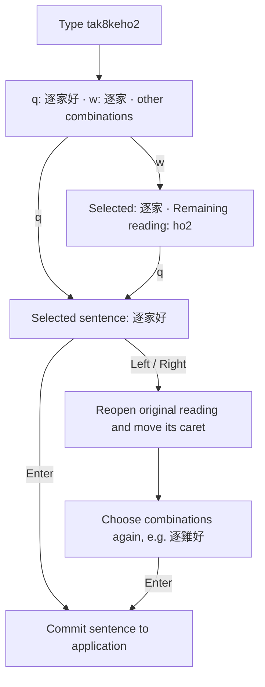
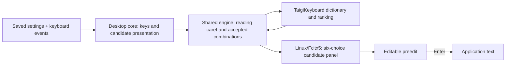

> Historical Obsidian export, captured November 6, 2026. The original report's
> versions, test totals, and installation claims apply to its recorded revision.
> Machine-specific paths were made portable; referenced local artifacts are
> identified but are not included here. See [export provenance](README.md) and
> [current development progress](../../PROGRESS.md) before following old commands.

# TaigiKeyboard change report — English (en-US)

Date: October 8, 2026 (Asia/Taipei)  
Scope: local source changes, Linux/Fcitx5 installation, verification, and workspace organization.

## Result

TaigiKeyboard now has an optional sentence mode that follows 意傳's letter-based selection of Hanji combinations. Selected text remains editable inside the input method until Enter commits it to the application. This mode is enabled for your account and was verified after restarting Fcitx5.

The implementation uses TaigiKeyboard's own engine and dictionaries. It does not embed Rime or reproduce every 意傳 feature.

## Design reference

I inspected the locally installed 意傳 `pojhan` schema and exercised it in isolated sessions using the real librime library. The relevant reference behavior is six candidates selected with `q w d f z x`, selection of complete or shorter reading-prefix combinations, and cursor movement through the original reading.

The earlier local implementation that edited individual Hanji cells was removed. The final implementation reopens the reading for a selected combination and lets you select combinations again.

See the recorded reference session (original local artifact: `issues/taigikeyboard-20261008/logs/validation/ithuan-reference-letter-flow.txt`).

## How to use it

| Action | Behavior |
|---|---|
| Type `tak8keho2` | Show candidate combinations, including `逐家好` and `逐家`. |
| Press `q` | Select the first combination, `逐家好`. |
| Alternatively, press `w`, then `q` | Select `逐家`, then select `好` from the remaining `ho2`. |
| Press Left/Right | Move through the original romanized reading; moving left into an accepted combination reopens it. |
| Press End | Move to the end of the remaining reading. |
| Press PageUp/PageDown | Change pages of six candidates. |
| Press Space | Confirm the highlighted candidate while keeping the sentence in composition. |
| Press Enter | Accept the active candidate where applicable, then send the sentence to the application. |
| Press Escape | Cancel the composing sentence. |

Numbers enter tones. Sentence mode uses the Standard tone scheme. Your display mode and script order apply while sentence mode is enabled: Combined offers Hanji and romanization separately, Romanization Only offers romanized candidates, and paired display follows the stored script order. Shift plus a selection letter chooses the alternate script. Show Typed Text First is also respected.

The q/w phrase example above and editing example below use Hanji-first paired display; Combined gives each script its own candidate cell.

For an editing example: select `逐家好`, press Left three times to place the reading caret after `tak8ke`, select the shorter `逐` candidate, then choose `雞` for `ke`. Press End and choose `好` from `ho2`. Enter commits `逐雞好`. This edits through reading spans; Left does not mean “select the preceding Hanji cell.”



## Package changes

| Component | Change and purpose |
|---|---|
| Shared composition engine (`engine/composing`) | Keep accepted combinations in composition; retrieve candidates for the reading before the caret; retain the untouched suffix; reopen accepted combinations for reselection. Candidate retrieval and learning use the same reading boundary. |
| Configuration protocol (`engine/protos`) | Add the optional `editable_sentence_enabled` field. The default is off. |
| Desktop core (`desktop/crates/taigi-desktop-core`) | Persist `editableSentenceEnabled`, map six selection letters, respect stored display/script preferences and preserve alternate-script selection, prioritize longer reading spans, and implement Enter finalization. Suppress automatic trailing spaces in this mode. |
| Linux runtime (`linux/crates/taigi-linux-core`) | Use the same six-candidate page size for labels, navigation, clicks, and letter selection. |
| Tests and documentation | Add combination-selection and reading-reselection coverage, installed-addon checks, and usage documentation. |

Some additional test configuration constructors were updated for the new optional field. No new phonetic spelling rules were introduced.



## Installation and persistence

The local build is based on upstream TaigiKeyboard 3.6.13. It is installed as a per-user Fcitx5 addon; the system 3.6.10 package remains available. The user addon override points to `~/.local/lib/taigikeyboard-sentence/libtaigikeyboard.so`.

Matching dictionaries are installed under that addon's private `prefix/share/taigikeyboard/dictionaries/`. This is necessary because the newer engine rejects the older system package's association-file format. Keeping the engine and dictionary assets together fixes the earlier missing-Hanji-candidates installation problem.

The account setting `values.editableSentenceEnabled` is saved as `true` in `~/.config/taigikeyboard/settings.json`. Reopening an application or restarting Fcitx5 retains the feature. A full operating-system reboot has not been separately verified. An unfinished composition is temporary and should be committed before closing its application.

## Verification and limits

| Check | Recorded result |
|---|---|
| Composition package | 655 tests passed; two optional performance tests ignored. |
| Desktop core | 450 tests passed. |
| Linux core/platform/FFI | 58 tests passed. |
| Clippy | Passed for the composing, desktop-core, and Linux targets with warnings denied. |
| Installed addon | TL and POJ checks passed using the installed binary's dictionary paths. |
| Running Fcitx5 | Verified `w → 逐家`, `q → 好`, Enter commitment, and reading reselection producing `逐雞好`. |

The live Fcitx5 result (original local artifact: `issues/taigikeyboard-20261008/logs/validation/ithuan-running-fcitx.txt`) and validation logs (original local artifact: `issues/taigikeyboard-20261008/logs/validation`) provide the evidence. Logs named `ithuan-*` describe the final design; older logs record intermediate implementations.

An earlier broader engine run exposed a failing asynchronous user-data test at `dispatch/tests/user_data_writes.rs:298`. The same assertion failed on untouched upstream code; see the upstream reproduction (original local artifact: `issues/taigikeyboard-20261008/logs/validation/upstream-user-data-writes.log`). The entire workspace is therefore not reported as passing. Windows, macOS, and the unchanged GTK settings application were not built.

Candidate vocabulary and ranking still differ from 意傳. Space confirms a candidate rather than finalizing the sentence, following your requested Enter-only workflow. Text already committed to an application cannot be reopened by this feature. Source changes remain local and uncommitted.

## Deliverables and rollback

- Source patch (original local artifact: `issues/taigikeyboard-20261008/artifacts/taigikeyboard-editable-sentence.patch`)
- Source-level usage documentation (original local artifact: `taigikeyboard/docs/editable-sentence.md`)
- [Installation and rollback notes](TAIGI_SENTENCE_MODE.md)
- [Taiwanese report](CHANGE_REPORT_Taigi_Hanji.md)
- Workspace organization manifest (original local artifact: `workspace/organization/initial-file-type-moves-20261008.json`)

Run rollback from the workspace root only if you want to restore the earlier addon:

```sh
python3 issues/taigikeyboard-20261008/scripts/taigi-sentence-mode.py rollback issues/taigikeyboard-20261008/backups/taigi-sentence-backup-20261008-002402
fcitx5 -r -d
```

Rollback preserves unrelated current settings and learning records. Workspace files are grouped by the device issue and originating session, with reports, scripts, evidence, and backups kept together. No files were deleted. The source and build-tool paths remain in place so existing build configuration continues to resolve them.

## Correction: retain POJ and TL output

A user-reported regression showed that the first sentence-mode patch forced
Hanji-first paired display, suppressed the typed-roman candidate setting, and
disabled Shift selection of the alternate script. This prevented the user's
Combined display preference from offering POJ output. The installed-binary
reproduction selected `盙` instead of expected POJ `hó` for `ho2` followed by w.

The correction removes those forced settings and restores Shift selection.
For `ho2` in Combined, q selects `好` and w selects `hó`. In Hanji-first paired
display, Shift+Q selects `hó`; Romanization Only and romanization-first paired
display select it with q. Selections remain editable until Enter.

See the script-choice regression checks (original local artifact: `issues/taigikeyboard-20261008/scripts/check-taigi-script-choice.py`).
The earlier test totals above describe the original revision; verification of
this correction is recorded separately in the issue's logs.

Correction verification (original local artifact: `issues/taigikeyboard-20261008/logs/validation/poj-script-choice-fix.json`): desktop tests and all 21 Linux session tests passed, as did desktop/Linux Clippy. The installed addon passed four script-choice checks plus TL/POJ phrase editing. The restarted Fcitx5 service selected POJ `hó`, Hanji `好`, and mixed `hó好`, retaining each selection until Enter. No user display settings were overwritten.


## Correction: symbol table while composing

The editable-sentence extension caused a symbol-table regression. Typing `ho2`
then pressing **Ctrl+Alt+,** only selected `好`; the symbol table never opened.
The Linux opener called `commit_first`, which selected the highlighted candidate
but left the new editable sentence active. The opener then returned because a
composition was still running. This was reproduced in the installed addon and
in a failing Linux session regression test before changing the implementation.

The picker now finishes the whole editable sentence before opening. Selected
Hanji and POJ retain their script. Ordinary candidate selection stays editable;
opening the symbol table deliberately sends the sentence to the application.
Other input modes keep their existing commit policy. Symbols use the same
q/w/d/f/z/x page labels; PageUp/PageDown change pages, Enter picks the highlighted
symbol, and Escape closes the table.

Verification: all **452 desktop tests** and **22 Linux session tests** passed;
desktop/Linux Clippy and formatting checks passed. The installed addon passed
symbol opening, second-page selection, Enter, and Escape, plus all four script
choices and TL/POJ sentence editing. Fcitx5 was restarted and the corrected
addon was verified in a private client context. The first immediate post-restart
check failed on a sentence-selection assertion; two later live checks passed
without another code or settings change. Its cause was not established; the
first-attempt log is retained separately.

- Symbol regression checker (original local artifact: `issues/taigikeyboard-20261008/scripts/check-taigi-symbol-picker.py`)
- Running Fcitx5 verification (original local artifact: `issues/taigikeyboard-20261008/logs/validation/symbol-running-fcitx.txt`)
- Validation record (original local artifact: `issues/taigikeyboard-20261008/logs/validation/symbol-picker-fix.json`)

The previous addon is backed up as
`backups/libtaigikeyboard.before-symbol-picker-fix.so`. User display preferences
and Discord configuration were not changed.
